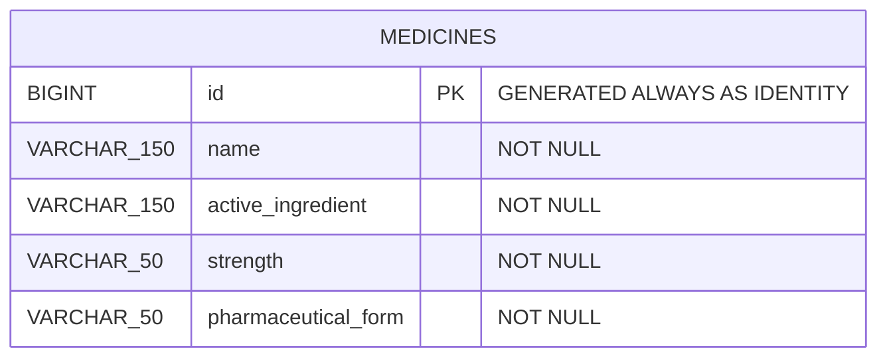

# MediCore – Base de datos

Esquema de medicamentos (issue #4). Rama: `feature/database-schema`.

**Tecnologías:** PostgreSQL 13+, SQL, `psql` / pgAdmin, Git Bash.

## Estructura

```
database/
├── schema/001_create_medicines.sql   # crea la tabla, restricciones e índices
├── seeds/001_seed_medicines.sql      # datos iniciales
├── docs/er_diagram.mermaid           # diagrama ER
└── README.md
```

## Modelo ER



### Tabla `medicines`

| Campo                 | Tipo           | Restricciones                          |
|-----------------------|----------------|----------------------------------------|
| `id`                  | `BIGINT`       | PK, autogenerado (identity)            |
| `name`                | `VARCHAR(150)` | NOT NULL, no vacío                     |
| `active_ingredient`   | `VARCHAR(150)` | NOT NULL, no vacío                     |
| `strength`            | `VARCHAR(50)`  | NOT NULL, no vacío (ej. `500 mg`)      |
| `pharmaceutical_form` | `VARCHAR(50)`  | NOT NULL, no vacío (ej. `Tableta`)     |

- **Unicidad:** `(name, strength, pharmaceutical_form)` no se puede repetir.
- **Índices:** `lower(name)` y `lower(active_ingredient)` para búsquedas sin distinguir mayúsculas.

## Cómo ejecutarlo (desde una base vacía)

Desde la raíz del repositorio, en Git Bash:

```bash
# 1. Crear la base de datos
createdb -U postgres medicore

# 2. Crear el esquema
psql -U postgres -d medicore -v ON_ERROR_STOP=1 -f database/schema/001_create_medicines.sql

# 3. Cargar los datos iniciales
psql -U postgres -d medicore -v ON_ERROR_STOP=1 -f database/seeds/001_seed_medicines.sql
```

Con **pgAdmin**: crear la base `medicore`, abrir *Query Tool* y ejecutar primero
`001_create_medicines.sql` y luego `001_seed_medicines.sql`.

Ambos scripts son **idempotentes**: se pueden volver a ejecutar sin errores ni duplicados.

## Verificación

```sql
SELECT count(*) FROM medicines;                                   -- 12
SELECT * FROM medicines WHERE lower(name) LIKE 'amox%';           -- 2 filas
```

Consulta de ejemplo para el backend:

```sql
SELECT id, name, active_ingredient, strength, pharmaceutical_form
FROM medicines
WHERE lower(name) LIKE lower('%' || :search || '%')
ORDER BY name;
```

## Acuerdo con backend

Campos iniciales: `id`, `name`, `active_ingredient`, `strength`, `pharmaceutical_form`.
Cualquier campo nuevo (precio, stock, etc.) se agrega con un script nuevo
(`002_...sql`), sin modificar el `001`.
