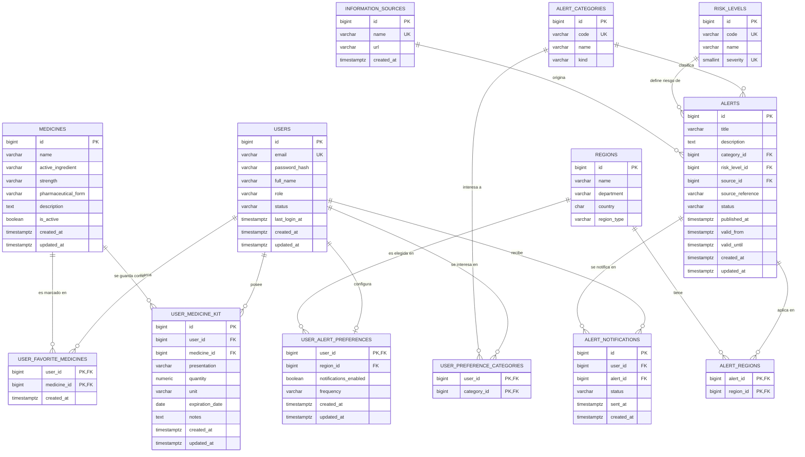

# Modelo entidad-relación y esquema

Cubre los issues #23, #59, #60, #61 y #62. Las migraciones están en `schema/` (001 a 009).

## Catálogo
- **medicines**: PK `id`. Única la presentación `(name, strength, pharmaceutical_form)`. Textos obligatorios y no vacíos.

## Usuarios (#25, #61)
- **users**: PK `id`. `email` único sin distinguir mayúsculas (índice sobre `lower(email)`), con formato válido y **siempre guardado en minúsculas y sin espacios** (restricción `ck_users_email_normalized`). `role` ∈ {ADMIN, USER}; `status` ∈ {ACTIVE, INACTIVE, BLOCKED}. `password_hash` guarda solo el hash BCrypt.
- Todas las tablas con datos personales referencian `users(id)` con `ON DELETE CASCADE`: al eliminar un usuario no quedan registros huérfanos, y cada registro tiene un único propietario.

## Favoritos (tabla intermedia)
- **user_favorite_medicines**: PK compuesta `(user_id, medicine_id)`, FK a `users` y `medicines` (`CASCADE`). Un usuario no puede marcar dos veces el mismo medicamento.

## Botiquín personal (#62)
- **user_medicine_kit**: cada fila pertenece a un `user_id` (`CASCADE`) y apunta a un medicamento del catálogo (`RESTRICT`: no se puede borrar del catálogo un medicamento que alguien tiene en su botiquín; usa `is_active = false`).
- `presentation` (texto, ej. «Caja x 20 tabletas»), `quantity` ≥ 0, `unit`, `expiration_date` de tipo `DATE` (ISO `yyyy-mm-dd`). Marcas de tiempo `created_at`/`updated_at` en UTC (`timestamptz`).
- Índice `(user_id, expiration_date)`: sirve para listar el botiquín y para la consulta de próximos a vencer.
- Toda operación de actualización o eliminación debe filtrar por `id` **y** `user_id`.

## Alertas por temporada (#59)
- **alert_categories**: `code` único; `kind` ∈ {SANITARIA, AMBIENTAL}.
- **risk_levels**: `code` y `severity` únicos (mayor severidad = más grave). Iniciales: Bajo, Moderado, Alto, Crítico.
- **regions**: ciudad, departamento o región; única por `(name, department, country)`.
- **information_sources**: nombre único y URL. Cada alerta tiene `source_id` obligatorio (procedencia) y opcionalmente `source_reference` (enlace al boletín original).
- **alerts**: categoría, nivel de riesgo y fuente obligatorios (`RESTRICT`). Fechas: `published_at` (publicación en la fuente), `valid_from` y `valid_until` (vigencia; `NULL` = sin fin), `updated_at` (se actualiza automáticamente). Restricción `valid_until > valid_from`. `status` ∈ {ACTIVE, CANCELLED}.
- **alert_regions**: PK `(alert_id, region_id)`. Una alerta puede aplicar a varias regiones. Índices por `region_id` y `(category_id, valid_from, valid_until)` para consultar por ubicación y categoría.
- Una alerta está **vigente** cuando `status = 'ACTIVE'`, `valid_from <= now()` y (`valid_until IS NULL` o `valid_until > now()`).

## Preferencias y notificaciones (#60)
- **user_alert_preferences**: una fila por usuario (PK `user_id`). Región elegida (`SET NULL` si la región desaparece), `notifications_enabled` y `frequency` ∈ {IMMEDIATE, DAILY, WEEKLY}.
- **user_preference_categories**: categorías de interés (PK `(user_id, category_id)`).
- **alert_notifications**: registro de alertas notificadas. `UNIQUE (user_id, alert_id)` impide notificar dos veces la misma alerta al mismo usuario; `status` ∈ {PENDING, SENT, FAILED, READ}, y `SENT` exige `sent_at`. Para saber si ya se notificó: `SELECT EXISTS (SELECT 1 FROM alert_notifications WHERE user_id = ? AND alert_id = ?)`; para registrar sin duplicar: `INSERT ... ON CONFLICT (user_id, alert_id) DO NOTHING`.
- Las preferencias viven en la base de datos, por eso permanecen después de cerrar sesión.

## Pendiente
- Backend debe aprobar este diagrama y los nombres de campo antes de integrarlos.
- No se creó tabla de **historial** (el issue #61 dice «cuando corresponda»): no está definida todavía. Si el equipo la define, su FK `user_id` debería seguir el mismo patrón (`REFERENCES users(id) ON DELETE CASCADE`).
