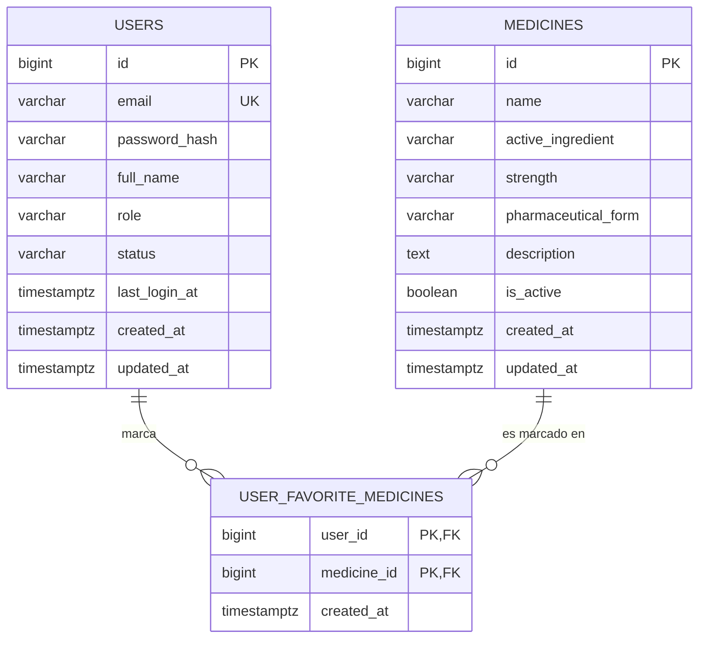

# Modelo entidad-relación (issue #23)

## Entidades y restricciones
- **medicines**: PK `id` (identity). Única la presentación `(name, strength, pharmaceutical_form)`. Campos de texto obligatorios y no vacíos.
- **users**: PK `id`. `email` único sin distinguir mayúsculas (índice sobre `lower(email)`) y con formato válido. `role` ∈ {ADMIN, USER}; `status` ∈ {ACTIVE, INACTIVE, BLOCKED}. `password_hash` guarda solo el hash BCrypt.
- **user_favorite_medicines** (tabla intermedia): PK compuesta `(user_id, medicine_id)`, con FK a `users(id)` y `medicines(id)`, ambas `ON DELETE CASCADE`. Evita que un usuario marque el mismo medicamento dos veces.

## Relaciones
`users` y `medicines` tienen una relación **muchos a muchos**: un usuario puede marcar varios medicamentos como favoritos y un medicamento puede ser favorito de varios usuarios. Se resuelve con la tabla intermedia `user_favorite_medicines`:

- `users` 1 — N `user_favorite_medicines` (por `user_id`)
- `medicines` 1 — N `user_favorite_medicines` (por `medicine_id`)

Si más adelante se necesita inventario o auditoría, se agregarían tablas similares.

## Pendiente para aceptación
Backend debe aprobar este diagrama y los nombres de campo antes de integrarlos.
